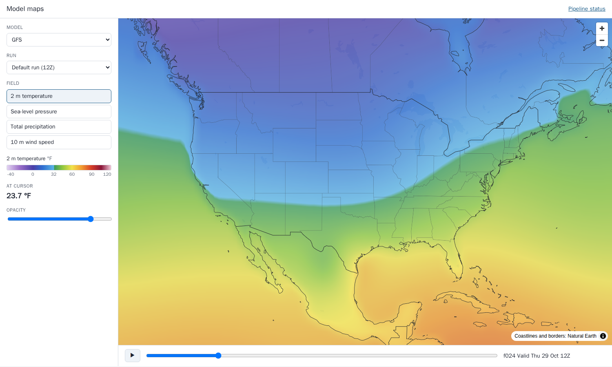
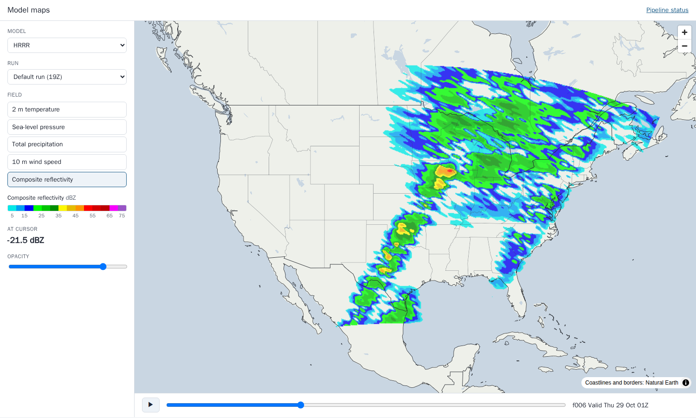
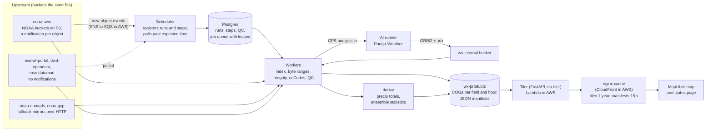
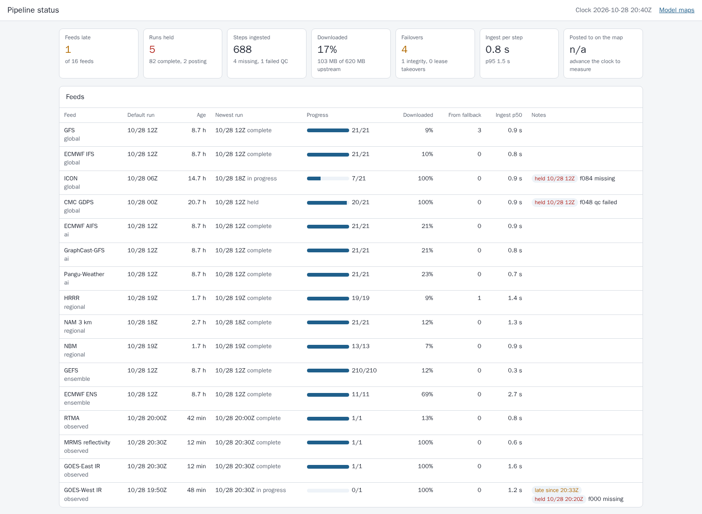
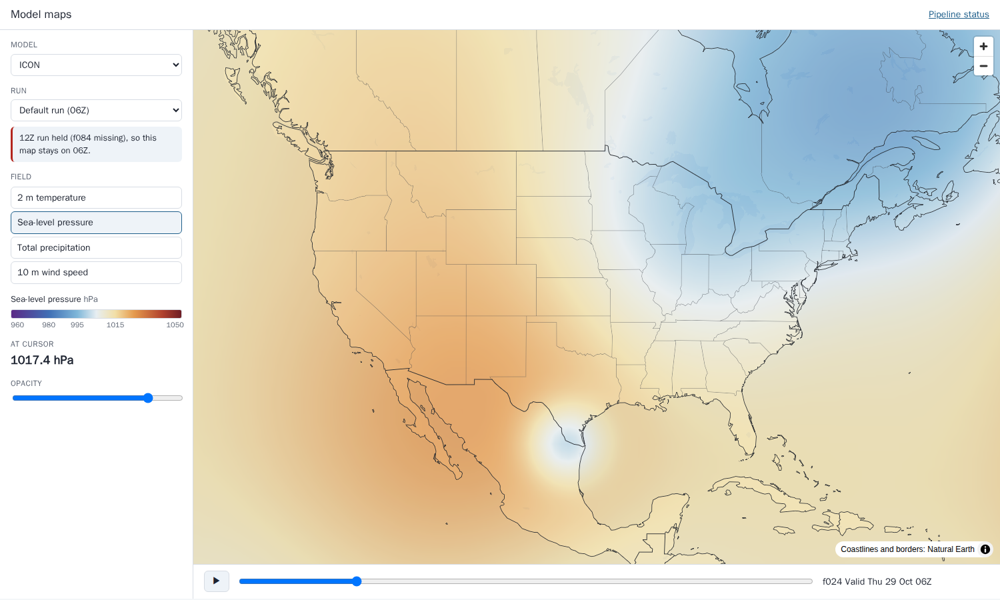

# Weather model tile pipeline

Numerical weather prediction, AI model, radar and satellite data turned into interactive web maps. The pipeline ingests 16 feeds (GFS, ECMWF IFS, ICON, CMC GDPS, ECMWF AIFS, GraphCast-GFS, Pangu-Weather, HRRR, NAM 3 km, NBM, GEFS, ECMWF ENS, RTMA, MRMS, GOES-East and GOES-West) from GRIB2 and netCDF. It downloads only the GRIB2 messages it maps, using HTTP range requests against each file's index, and falls back to a second mirror when the primary lacks an object or serves a damaged one. Every field is quality-controlled before anything is published. Each field and forecast hour is warped from its native grid (latitude/longitude, Lambert conformal, or the GOES fixed grid) to a Web Mercator Cloud-Optimized GeoTIFF aligned to the tile grid. A tile server renders and colors map tiles on demand behind a cache that never needs invalidating. A MapLibre map and a status page sit on top.

This is a reference implementation of the architecture behind a weather map platform I built for a mid-sized energy trading company. The production build is under NDA, so a few integrations are abstracted behind adapters: S3 and CloudFront are SeaweedFS and nginx in Compose, NOAA's SNS notifications arrive through a table instead of SQS, the upstream servers are buckets the seed fills, and Pangu-Weather (which needs its weights and a GPU) is a runner that writes synthetic output in the same layout. It runs on synthetic data, and every company, place, person, phone number and figure in it is made up.

[](https://github.com/AlexKurinets/weather-model-tile-pipeline/actions/workflows/ci.yml)





## Architecture



Compose runs six services. `db` is Postgres 16 and `s3` is SeaweedFS. `seed` is a one-shot job that creates the buckets, sets the synthetic clock and posts the upstream files. `worker` is the scheduler plus four worker processes. `tiler` is the FastAPI tile and status server. `cdn` is nginx, serving the map and caching tiles and manifests.

## The synthetic day

The seed sets the clock to 20:40 UTC on 28 October 2026 and posts everything that would be upstream by then: the last two complete runs of each model (one for the ensembles), anything still posting, the last 12 RTMA analyses and the last 18 radar and satellite frames. It writes 1,556 objects in each feed's real layout. GFS, HRRR, NAM, NBM, GEFS, GraphCast-GFS and RTMA are multi-message GRIB2 files with a wgrib2 `.idx`. IFS, AIFS and ENS are GRIB2 with an ECMWF JSON `.index`, and ENS has every member of a step in one file. ICON comes as one bzip2 file per variable, GDPS as one plain file per variable, and MRMS as gzipped GRIB2 on its local discipline 209. GOES is ABI L2 netCDF with scaled int16 values on the fixed grid. Five faults are injected, the same way every time:

| Feed | Fault | What the pipeline does |
|---|---|---|
| GFS 12Z | f048, f054 and f060 never reach the AWS bucket | No notification arrives; the poller catches the steps past their expected time and fetches them from NOMADS. The run completes and becomes the default. |
| HRRR 19Z | f07 on the AWS bucket stops 40% of the way into a message the worker needs | The range read fails the GRIB length check, the step is refetched from NOMADS. |
| ICON 12Z | f084 is never posted | At its deadline the step is marked missing and the run is held. The map stays on 06Z until 18Z completes. |
| GDPS 12Z | 2 m temperature at f048 is a frozen field of 273.15 K | QC fails the step (standard deviation 0), the run is held, the map stays on 00Z. |
| GOES-West | the last 45 minutes of frames are missing | The feed is flagged late on the status page; the missed frames are marked missing. |

After the backlog drains, which takes about four minutes on a laptop, `wxtiles status` shows:

```
clock 2026-10-28T20:40:00Z   queue 0   runs: 82 complete, 5 held, 2 in progress
steps: 688 done, 4 missing, 1 failed QC; downloaded 103 MB of 620 MB (17%); failovers 4; ingest p50 800 ms

source     live run       age h  newest        state            steps  fetched fallback  notes
gfs        2026102812       8.7  2026102812    complete       21/21         9%        3  
ifs        2026102812       8.7  2026102812    complete       21/21        10%        0  
icon       2026102806      14.7  2026102818    in_progress     7/21       100%        0  held 2026102812: f084 missing
gdps       2026102800      20.7  2026102812    held           20/21       100%        0  held 2026102812: f048 qc failed
aifs       2026102812       8.7  2026102812    complete       21/21        21%        0  
graphcast  2026102812       8.7  2026102812    complete       21/21        21%        0  
pangu      2026102812       8.7  2026102812    complete       21/21        22%        0  
hrrr       2026102819       1.7  2026102819    complete       19/19         9%        1  
nam        2026102818       2.7  2026102818    complete       21/21        12%        0  
nbm        2026102819       1.7  2026102819    complete       13/13         7%        0  
gefs       2026102812       8.7  2026102812    complete      210/210       12%        0  
ens        2026102812       8.7  2026102812    complete       11/11        68%        0  
rtma       202610282000     0.7  202610282000  complete        1/1         13%        0  
mrms       202610282030     0.2  202610282030  complete        1/1        100%        0  
goes_east  202610282030     0.2  202610282030  complete        1/1        100%        0  
goes_west  202610281950     0.8  202610282030  in_progress     0/1        100%        0  LATE since 20:33; held 202610282020: f000 missing
```

The pipeline downloaded 103 MB of the 620 MB the upstream objects add up to (17%), varying by layout:

- 8 to 13% for the multi-message NOAA files, and 10% for ECMWF IFS.
- 21 to 22% for the AI-model files, which carry fewer filler messages.
- 68% for ECMWF ENS, where every member's temperature and precipitation are wanted.
- 100% for the whole-file feeds (the ICON and GDPS per-variable files, MRMS and GOES), which have nothing to skip.

Ingest takes about 0.8 s per step at the median. In the run behind these numbers, `wxtiles advance --minutes 60` then posted 59 steps at once, and they reached the map a median of 8.5 s after landing upstream (p95 17.1 s). The figure moves by a few seconds from run to run, and the tail is steps queueing behind four worker processes. The production figure, NOAA posting a GFS forecast hour to that hour on the map, was a median of about 3 minutes on full-size files.





## Design decisions

**Download only the messages that are mapped.** `src/wxtiles/idx.py` parses the wgrib2 `.idx` that NOAA publishes beside each file and the JSON-lines `.index` ECMWF publishes. It picks messages by variable and level text (`TMP:2 m above ground`), never by message number, because NCEP reorders files between model versions. Adjacent messages are merged into one HTTP range request. A source can override the text: HRRR carries `MSLMA`, not `PRMSL`. When an accumulation is offered over two windows (HRRR's f07 has 0-7 h and 6-7 h), the run total is taken. A real 0.25 degree GFS file is about 500 MB and 700 messages, and production pulled about 25 MB of it per forecast hour. The synthetic files have 8 to 32 messages, so the saving here is smaller (see the status block above).

**Distrust every download.** `fetch.py` tries the source's mirrors in registry order. `gribio.split_messages` accepts a range only if its length matches what the index promised and each message starts with `GRIB`, is edition 2, declares a length that fits and ends in `7777`. Whole files are checked against the HEAD size, and gzip and bzip2 streams must decompress. A mirror that fails a check is skipped for the next one. If no mirror has the step, it is retried until its deadline (expected posting time plus the source's grace) and then marked missing.

**Notifications first, polling as the safety net.** NOAA's Open Data buckets publish an SNS message per new object. Here that is the `upstream_events` table, which `worker.consume_events` turns into ingest jobs, matching keys to runs and steps with a regex compiled from each source's path template. ECMWF, DWD and MSC publish no notifications, so `worker.poll_due` queues any step whose expected time has passed. It does the same for a notifying source five minutes after the expected time, which is how an object that reached only a fallback mirror is still found.

**Grids from file metadata, never from assumptions.** `grids.py` rebuilds each grid from the message's own keys. Longitudes may run 0 to 360 or -180 to 180, rows north-to-south or south-to-north, and Lambert conformal grids carry their standard parallels, orientation and earth radius. The GOES fixed grid comes from the netCDF projection variable, with scan angles times perspective height. Global grids are rolled to start at -180 and get a repeated column at the dateline, so interpolation has data on both sides. QC compares the decoded grid with `config/sources.yaml`, so an upstream grid change stops at ingest instead of shifting a map.

**One COG per field and hour, aligned to the tile grid.** `cog.py` warps each field (bilinear, with NaN carried through so missing radar coverage never bleeds into echoes) to EPSG:3857 at one zoom level's resolution. The extent is snapped outward to that zoom's tile boundaries and written as a DEFLATE COG with 256 px blocks and overviews. One web tile at the COG's zoom is one block read, every field from the same grid lands on the same pixels, and QC can compare two runs pixel for pixel. Values are rounded to each field's precision first (0.1 °F, 0.01 in), as GRIB packing does, which also lets DEFLATE compress them far better.

**QC before publishing.** `qc.py` runs on decoded values in the file's own units. It checks physical range, missing share, frozen fields (standard deviation under 0.001), grid against registry, and, for 2 m temperature and sea-level pressure, the mean absolute change against the previous run at the same valid time (limits in `config/sources.yaml`). Every check is stored in `qc_results`. A failed step publishes nothing.

**Publish hours as they pass, promote runs only when complete.** A forecast hour appears in its run's manifest the moment it passes QC, so a run that is still posting can be opened. `pipeline.finalize` makes a run the default only when every step is in and every expected product exists. A run with a missing or failed step is held with the reason, and the previous complete run stays the default. A newer complete run skips over a held one without waiting for it.

**Accumulations rebuilt from what each center encodes.** GFS, GEFS, NBM and GraphCast reset their precipitation every 6 hours (NAM every 3). ECMWF, DWD, MSC and HRRR accumulate from the start. `pipeline.derive` reads the window from each message's step range and chains windows into run totals, so totals never double count or drop a bucket. For ensembles it computes the mean and spread of 2 m temperature and the mean and chance of 1 inch of precipitation once every member of an hour is in, and only those statistics are published.

**Tiles on demand, cached forever.** `api.py` reads a tile from the COG with rio-tiler and colors it with the field's table (`colormaps.py`), so a palette change needs no re-ingest. The COG key follows from the URL, so the tiler needs no database for tiles. The URL names the run, so a tile never changes and is served with `max-age=31536000, immutable`. Only the manifests (`manifests.py`) expire, after 15 seconds here and 60 in production, which is how a new run reaches open maps without a CDN invalidation. A request for an hour that is not published yet gets a 404 cached for 15 seconds. When a run is promoted, a warm-up job requests its default field's zoom-3 tiles over North America through the cache.

**A queue that survives losing a worker.** Jobs live in Postgres and are claimed with `FOR UPDATE SKIP LOCKED` and a lease (`db.claim`). A job whose worker dies is taken over when the lease expires, which is how work on a reclaimed Spot instance gets finished elsewhere. Every handler is idempotent, and jobs are de-duplicated while queued.

**AI models are feeds like any other.** AIFS and GraphCast-GFS are ingested from their publishers. Pangu-Weather is run by us: when the GFS analysis (f000) of a cycle is ingested, an `ai_run` job runs the model (`ai.py`) and writes GRIB2 with a wgrib2 index to the `wx-internal` bucket, announcing each file. The normal ingest path, QC included, picks it up from there. Pangu-Weather has no precipitation output, so its run has no precipitation field rather than an empty one.

## Running it

```bash
cp .env.example .env    # optional: change host ports
docker compose up -d --build --wait
docker compose logs -f worker    # about four minutes to work through the seeded backlog
docker compose exec worker wxtiles status
```

The map is at http://localhost:8210 and the status page at http://localhost:8210/status.html. The map's URL keeps its state, so http://localhost:8210/#icon/live/mslp/24 opens ICON sea-level pressure at f024 on the default run. Pick a held or still-posting run from the Run menu to see why it isn't the default. Hovering over the map reads the value under the cursor from the COG.

The same from the command line:

```bash
docker compose exec worker wxtiles events --limit 20    # failovers, holds, promotions
docker compose exec worker wxtiles qc                   # every failed QC check
docker compose exec worker wxtiles runs icon            # ICON runs and their states
curl -sI http://localhost:8210/tiles/gfs/2026102812/mslp/24/3/1/2.png   # X-Cache-Status: MISS, then HIT
curl -sI http://localhost:8210/tiles/gfs/2026102812/t2m/24/3/1/2.png    # HIT already: warmed on promotion
curl -s http://localhost:8210/manifests/icon/latest.json
curl -s "http://localhost:8210/api/point?source=gfs&run=2026102812&field=t2m&fhour=24&lon=-95&lat=40"
```

Watch a new cycle arrive. This moves the synthetic clock forward an hour and posts what NOAA, ECMWF, DWD and MSC would have posted in that hour: GFS 18Z starts, Pangu-Weather runs from its analysis, ICON 18Z completes and becomes the default, and new radar and satellite frames appear.

```bash
docker compose exec worker wxtiles advance --minutes 60
docker compose exec worker wxtiles status
```

Failover drills: take the AWS bucket away for the next 20 minutes of posting, or kill the worker partway through a backlog and watch its jobs taken over after their two-minute lease.

```bash
docker compose exec worker wxtiles advance --minutes 20 --primary-down
docker compose kill worker && docker compose up -d worker
```

`docker compose down -v` removes everything. Without Docker you need Python 3.11+, a Postgres in `DATABASE_URL` and any S3 API in `WX_S3_ENDPOINT`. Then run `pip install -e .`, `wxtiles seed`, `wxtiles worker` and `uvicorn wxtiles.api:app`.

## Tests

```bash
docker run -d --name wx-test -e POSTGRES_USER=wx -e POSTGRES_PASSWORD=wx -e POSTGRES_DB=wx_test -p 5523:5432 postgres:16
TEST_DATABASE_URL=postgresql://wx:wx@localhost:5523/wx_test pytest
```

47 tests across five files:

- `test_idx.py` covers inventory parsing: submessages sharing a range, matching by text when the file is reordered, run total over last hour, HRRR's MSLMA override, merged ranges, and ECMWF members.
- `test_grids_and_cog.py` covers the dateline roll, scan-direction flips, the Lambert first point landing where the file says, the geostationary grid, registry mismatch, tile-aligned extents, and NaN staying NaN through the warp.
- `test_formats_and_fetch.py` writes every format and decodes it back, catches truncation, short reads and bad gzip, falls back from a missing or truncated primary, makes HTTP range requests, maps every source's keys back to run and step, and checks which runs are tracked.
- `test_qc_and_colors.py` covers QC and the color tables.
- `test_stack.py` seeds a cut-down copy of the registry (same faults, coarser grids, shorter runs) into Postgres and runs the worker until idle. It checks each fault's outcome, chained precipitation totals never decreasing, ensemble statistics, Pangu-Weather's trigger, late detection, lease takeover, the tile, point, manifest and status endpoints, the dashboard pages, and a clock advance that completes ICON 18Z.

CI runs ruff and the tests against a Postgres service. A second job runs `terraform validate` on `deploy/aws`, and a third runs `scripts/smoke.sh`, which brings the Compose stack up and runs every command block in this README.

## On AWS

`deploy/aws` is the production shape in Terraform:

- An S3 bucket with lifecycle rules (COGs expire after 10 days).
- An SQS queue with a dead-letter queue, subscribed to NOAA's SNS topics.
- RDS Postgres for run state.
- The worker container on a Spot Auto Scaling group that scales on queue depth.
- A g5.xlarge Spot group, scheduled up for half an hour after each GFS analysis, whose workers take only `ai_run` jobs (`wxtiles worker --kinds ai_run`).
- The tiler as a Lambda container image (`Dockerfile.lambda`, via the Lambda Web Adapter).
- CloudFront, with a one-year cache policy for `/tiles/*`, 60 seconds for `/manifests/*` and none for `/api/*`.
- Alarms on queue age and on the late-feeds metric the scheduler publishes.

The configuration passes `terraform validate` in CI. It has not been applied from this repository.

## Layout

```
config/sources.yaml        every feed: grid, cycles, hours, posting schedule, mirrors, paths, fields; QC limits
src/wxtiles/registry.py    sources, runs, steps, expected times, object keys and key parsing
src/wxtiles/idx.py         .idx and .index parsing, message selection, range merging
src/wxtiles/fetch.py       mirror failover and integrity checks
src/wxtiles/gribio.py      GRIB2 splitting, ecCodes decoding, ABI netCDF
src/wxtiles/grids.py       native grids to CRS and transform
src/wxtiles/cog.py         tile-aligned Web Mercator COGs
src/wxtiles/qc.py          checks
src/wxtiles/pipeline.py    ingest, derive, finalize, AI run, warm-up
src/wxtiles/worker.py      scheduler and worker loop
src/wxtiles/manifests.py   index, latest and run manifests
src/wxtiles/api.py         tiles, point values, manifests, status API
src/wxtiles/synth/         synthetic atmosphere, file writers, the posting schedule and faults
web/                       MapLibre map, status page, Natural Earth coastlines and borders
deploy/                    nginx (the CDN stand-in) and the AWS Terraform
```

## What is deliberately left out

- Real data. The atmosphere in `synth/atmosphere.py` is a handful of drifting pressure systems, a cold front with convection and a diurnal cycle. It is shaped to look coherent on a map, not to verify against anything.
- Full-resolution grids. Global models are on 1 degree grids here, regional models on 12 to 15 km, MRMS on 0.07 degrees and GOES at roughly 9 km, with 10 ensemble members instead of 31 or 51. This keeps the stack up in minutes. The code paths are the same.
- The Pangu-Weather runner itself (ONNX on a GPU). The adapter interface is in `ai.py`.
- Single-site NEXRAD Level II volumes. Radar here is the MRMS mosaic, which is what the map showed in production.
- Contoured overlays such as isobars, user accounts, and cleanup of old runs. In AWS, the S3 lifecycle rule handles cleanup.

MIT, Alex Kurinets.
